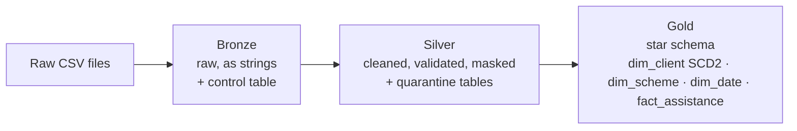

# Medallion Data Pipeline on Databricks: Social Assistance Analytics

A Bronze → Silver → Gold pipeline built on Databricks (PySpark + Delta tables) that turns messy client and assistance files into a trusted star schema, so one business question can be answered reliably:

> **How much assistance goes to different household income groups, across regions and schemes, and how does this change over time?**

All data is **synthetic** (generated with Python Faker). No real personal data is used.

---

## Why this project

Client details such as address and household income change over time and those changes matter when analysing who received assistance. If you simply overwrite old values, past assistance gets attributed to the wrong household circumstances. This project shows how to keep that history correct, while also handling dirty data and sensitive personal information (NRIC, names).

## Architecture

| Layer | What it does |
|---|---|
| **Bronze** | Keeps raw data exactly as received (all columns as strings). Adds `ingest_ts` and `source_file`. Every load is logged in a **control table**. |
| **Silver** | Standardises, type-checks and validates. Hashes NRIC, masks names. Failed rows go to **quarantine tables** with a reason. |
| **Gold** | Star schema for reporting. `dim_client` tracks history with **SCD Type 2**. |

## Key features

- **Control table (idempotent loads):** each file load is logged with row counts and status (`SUCCESS`/`FAILED`). Files already loaded are skipped, so re-running a notebook never duplicates data. Schema drift is detected and logged as a failure.
- **Quarantine problematic rows:** rows that fail data-quality checks are kept with the original values, a failure reason and an `OPEN` status.
- **Remediation workflow:** quarantined rows are re-validated when later data arrives (for example, orphan assistance cases are released once their client appears). Every action is written to an audit table.
- **PII protection:** NRIC is salted and hashed (SHA-256); names are partially masked. No raw NRIC reaches silver or gold.
- **SCD Type 2 on `dim_client`:** when a client's address, region, income or household size changes, the old row is closed and a new version is inserted.

## Data quality problems injected on purpose

Because the defects are planted, the expected results are known in advance, which makes it possible to test the pipeline.

| Table | Defects |
|---|---|
| Clients | Lowercase NRIC, invalid or too-short NRIC, missing income, negative income, extra whitespace in names, exact duplicate rows |
| Clients (Day 2) | 50 changed addresses/regions, 20 new clients, 10 bad NRICs |
| Assistance | Negative or missing amount, orphan client ID, unknown scheme, invalid status, future application date, duplicate cases |

## Notebooks

| # | Notebook | Purpose |
|---|---|---|
| – | `Overview.ipynb` | Problem statement, data profiling of the raw files |
| 1 | `01_generate_synthetic_data.ipynb` | Generates the CSV files with deliberate defects; resets the environment |
| 2 | `02_bronze_ingestion.ipynb` | Ingests raw files with the control table |
| 3 | `03_silver_cleaning.ipynb` | Cleaning, validation, masking, quarantine, reconciliation, remediation |
| 4 | `04_gold_reporting.ipynb` | Star schema, SCD2 dimension, fact table, reporting queries, metrics |

## Tech stack

Databricks · PySpark · Delta Lake · Unity Catalog Volumes · SQL · Python (pandas, Faker)

## Limitations and next steps

- Synthetic, small-scale data; no real orchestration (jobs are run manually).
- The hashing salt is hardcoded for the demo; production would use a secret scope.
